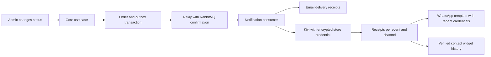

# WhatsApp and order notifications through Kivi

HU-13 and HU-14 are managed in `/dashboard/integrations`. HU-15 uses the existing outbox and RabbitMQ consumer. Order state changes, event publication, and message delivery run in Core and its workers.

## Operator setup

1. Deploy the Kivi backend with Alembic revision `f4b6d8a0c2e5` by running `alembic upgrade head` in its deployment environment. The new tables use RLS and grant no browser access.
2. Apply `supabase/migrations/20261028180000_kivi_order_notifications.sql` in Canal Digital. It provides a restricted projection for `notification_worker_role`, fenced against the committed outbox event and tenant. Order transitions remain in TypeScript and their existing transaction.
3. Set `KIVI_NOTIFICATIONS_ENABLED=true` in the notification worker and web deployment. The web flag displays configuration status; it does not probe worker health. Use the same base64-encoded, 32-byte `KIVI_TOKEN_ENCRYPTION_KEY` used for pairing. Keep it server-side.
4. Restart the notification worker. Compose forwards both variables. Preserve the existing SMTP, database, and RabbitMQ configuration. When the Kivi integration is enabled, an SMTP probe failure allows Kivi consumption to continue.
5. Generate a Kivi pairing code with permission to configure WhatsApp and send order notifications, then pair the store again. This explicitly grants `channels:whatsapp:write` and `notifications:write` alongside catalog permissions. Existing links do not gain permissions automatically. Automatic delivery requires an encrypted paired credential; legacy links using per-store environment variables must be paired again.
6. Validate and save the Meta Phone number ID and token from Canal Digital. Kivi validates with Meta and encrypts the token. Canal Digital retains no second copy of the WhatsApp token. Connection status confirms credentials; it does not confirm final message delivery.
7. Configure Kivi's `/api/v1/webhook` in Meta with `META_VERIFY_TOKEN`, `META_APP_SECRET`, and message subscriptions for the corresponding number. This belongs to the Kivi deployment; saving a token does not configure the external webhook.
8. Obtain Meta approval for a utility template, defaulting to `order_status_update`, with **two body parameters**: order number followed by status. Select its exact name and language (`es` or `en`) in the panel, then enable the desired channels. See the [Meta template reference](https://whatsapp.github.io/WhatsApp-Nodejs-SDK/api-reference/messages/template/).

The implementation notes report migration checks against temporary PostgreSQL with synthetic data. They do not report production migrations, environment changes, service publication, or real message delivery.

## Delivery behavior

- The six existing events cover confirmed, paid, processing, shipped, delivered, and cancelled orders. Notifications preserve the event's original identity and status.
- Recipient phone numbers require a country code. The Core recipient value object removes supported presentation separators (spaces and hyphens) without guessing the country of a local number. An approved WhatsApp template can notify a new buyer without a previous Kivi conversation. Orders do not create or merge contact identities.
- Widget updates require a recent web conversation belonging to the same canonical contact. Identity linking uses Kivi's existing verification. A browser-submitted phone number never authorizes conversation access.
- Widget notifications persist in history and appear on the next widget query. No push connection or operating-system notification is added.
- Each storefront resolves its linked Kivi tenant's public widget key by store slug. Unlinked stores, inactive widgets, and unavailable Kivi services mount no store widget. The general directory retains its global assistant. Configure an active widget in Kivi and allow Canal Digital's public origin. The public query uses a read port and a 1.5-second HTTP timeout.
- Remote notification settings start disabled. Events acknowledged while both channels are disabled are not retained for retrospective delivery.
- Receipts are independent of email and separated by Kivi channel. `event_id` remains stable on retries. Before the first HTTP attempt, Canal captures encrypted recipient data in `core.kivi_notification_payloads` through a first-writer fence. Kivi also retains an encrypted snapshot. Later profile changes do not redirect or invalidate a prepared retry. Reusing an event with a different identity or status is rejected. Deduplication uses the Kivi tenant, application, and external business identity, surviving pairing again with the same account. Older events are skipped after a newer notification has been sent.

## Operations and failures

RabbitMQ retains its existing retry intervals (30 seconds, 2 minutes, 10 minutes, and 30 minutes) and `.dead-letter` queue. Kivi returns 429 for Meta rate limits so delivery can be retried. Temporary Kivi connection failures also trigger retries. Invalid credentials, missing permissions, and missing contacts reach the error queue.

Kivi durably reserves each business, order, and channel combination and persists a `sending` fence before calling Meta. Concurrent statuses for the same order return 409 for the second attempt, allowing RabbitMQ to retry. Once the newer status completes, older statuses are skipped. Timeouts and ambiguous responses produce `unknown` and require reconciliation because Meta may already have accepted the message. A process crash between reservation and dispatch also requires review. `sent` means **accepted by Meta**; delivery and reading require subsequent evidence. The returned identifier is stored in `provider_message_id` for comparison with Meta webhooks.

Operators can inspect `connection_order_deliveries` through administrative access to locate `sending`, `unknown`, or `failed` records and reconcile them with Meta. Before changing a record to `pending` or releasing `active_event_id` in `connection_order_dispatch_cursors`, verify that Meta did not accept the message. A reservation left by a crashed process blocks later notifications for that order and channel until review. Exactly-once delivery to the external provider is not guaranteed. The browser has no manual resend action.

## Previously reported validation (October 28, 2026)

- Canal Digital: 1,298 tests passed and 42 skipped under the existing external-service conditions. `pnpm test --maxWorkers=4`, `pnpm lint`, and TypeScript checks for Core, Web, and Worker passed.
- Kivi: 2,440 backend tests passed, plus a separately executed PostgreSQL concurrency test; 749 frontend tests and TypeScript passed. Existing backend tests retained seven mock/resource warnings.
- Temporary PostgreSQL 18 on localhost with synthetic data: Canal's migration ran under a non-superuser. Checks covered the restricted projection, first-writer snapshot, direct-table access denial, anonymous access, and an event from another tenant.
- Kivi's new Alembic migration ran over its model base tables. Checks covered RLS with two tenants and a reservation across two concurrent PostgreSQL sessions. The full historical migration chain was not run from scratch, and production databases were unchanged.
- An independent review reported seven significant findings corrected. A local component preview with synthetic data covered loading, rejection, input retention, confirmation, and mobile sizing.

These are historical implementation notes, not additional checks executed by the current source audit. Deployment acceptance still requires real RabbitMQ, a Meta test number, and the correct tenant widget and origin. No real message delivery or production activation is reported.
