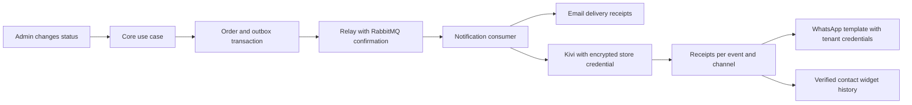

# WhatsApp and order notifications through Kivi

HU-13 and HU-14 are managed in `/dashboard/integrations`. HU-15 uses the existing outbox and RabbitMQ consumer. Order state changes, event publication, and message delivery run in Core and its workers.

## Operator setup

1. Deploy the Kivi backend with Alembic revision `f4b6d8a0c2e5` by running `alembic upgrade head` in its deployment environment. The new tables use RLS and grant no browser access.
2. Apply `supabase/migrations/20261028180000_kivi_order_notifications.sql` in Canal Digital. It provides a restricted projection for `notification_worker_role`, fenced against the committed outbox event and tenant. Order transitions remain in TypeScript and their existing transaction.
3. Set `KIVI_NOTIFICATIONS_ENABLED=true` in the notification worker and web deployment. The web flag displays configuration status; it does not probe worker health. Use the same base64-encoded, 32-byte `KIVI_TOKEN_ENCRYPTION_KEY` used for pairing. Keep it server-side.
4. Restart the notification worker. Compose forwards both variables. Preserve the existing SMTP, database, and RabbitMQ configuration. When the Kivi integration is enabled, an SMTP probe failure allows Kivi consumption to continue.
5. Generate a Kivi pairing code with permission to configure WhatsApp and send order notifications, then pair the store again. This explicitly grants `channels:whatsapp:write` and `notifications:write` alongside catalog permissions. Existing links do not gain permissions automatically. Automatic delivery requires an encrypted paired credential; legacy links using per-store environment variables must be paired again.
6. Validate and save the Meta Phone number ID and token from Canal Digital. Kivi validates with Meta and encrypts the token. Canal Digital retains no second copy of the WhatsApp token. Connection status confirms credentials; it does not confirm final message delivery.
7. Configure Kivi's `/api/v1/webhook` in Meta with `META_VERIFY_TOKEN`, `META_APP_SECRET`, and message subscriptions for the corresponding number. This belongs to the Kivi deployment; saving a token does not configure the external webhook.
8. Obtain Meta approval for a utility template, defaulting to `order_status_update`, with **two body parameters**: order number followed by status. Enter its exact name and approved language code in the panel (for example `es`, `es_MX`, or `en_US`), then enable the desired channels. Spanish and English regional codes are preserved; the status text follows the base language. The parser checks syntax, not whether Meta approved that locale for your template. See the [Meta template reference](https://whatsapp.github.io/WhatsApp-Nodejs-SDK/api-reference/messages/template/).

## Owner delivery diagnostics

Dashboard > Integrations now shows the ten most recent attempts recorded by Kivi, with channel, event ID, timestamp and safe receipt status. Refresh queries the server again; it never resends an event. `Accepted by Meta` means provider acceptance, not delivery/read confirmation. `sending`, `unknown` and `failed` require operator review if they persist. The `Configuration complete` badge describes saved configuration, not worker health.

Kivi exposes `GET /api/v1/connections/{connection_id}/notifications/deliveries` under `notifications:write`. The projection is bounded to ten rows and filters by the authenticated tenant and stable business identity, preserving visibility after re-pairing. It returns no phone numbers, encrypted payloads, tokens or raw provider errors. If the route is not yet deployed or is unavailable, the history reports unavailable while settings remain usable.

No attempts usually means that the worker did not invoke Kivi or that notifications were disabled when it did. Check `KIVI_NOTIFICATIONS_ENABLED=true` in the **notification worker**, restart it, verify restricted database functions and inspect RabbitMQ's `.dead-letter` queue. The same web variable only informs the UI. Turning either flag on does not replay events already acknowledged while disabled.

The implementation notes report migration checks against temporary PostgreSQL with synthetic data. They do not report production migrations, environment changes, service publication, or real message delivery.

## Delivery behavior

- The six existing events cover confirmed, paid, processing, shipped, delivered, and cancelled orders. Notifications preserve the event's original identity and status.
- Recipient phone numbers require a country code. The Core recipient value object removes supported presentation separators (spaces and hyphens) without guessing the country of a local number. An approved WhatsApp template can notify a new buyer without a previous Kivi conversation. Orders do not create or merge contact identities.
- Widget updates require a recent web conversation belonging to the same canonical contact. Identity linking uses Kivi's existing verification. A browser-submitted phone number never authorizes conversation access.
- Widget notifications persist in history and appear on the next widget query. No push connection or operating-system notification is added.
- Each storefront resolves its linked Kivi tenant's public widget key by store slug. Unlinked stores, inactive widgets, and unavailable Kivi services mount no store widget. The general directory retains its global assistant. Configure an active widget in Kivi and allow Canal Digital's public origin. The public query uses a read port and a 1.5-second HTTP timeout.
- Remote notification settings start disabled. Events acknowledged while both channels are disabled are not retained for retrospective delivery.
- Receipts are independent of email and separated by Kivi channel. `event_id` remains stable on retries. Before the first HTTP attempt, Canal captures encrypted recipient data in `core.kivi_notification_payloads` through a first-writer fence. Kivi also retains an encrypted snapshot. Later profile changes do not redirect or invalidate a prepared retry. Reusing an event with a different identity or status is rejected. Deduplication uses the Kivi tenant, application, and external business identity, surviving pairing again with the same account. Older events are skipped after a newer notification has been sent.

## Operations and failures

RabbitMQ retains its existing retry intervals (30 seconds, 2 minutes, 10 minutes, and 30 minutes) and `.dead-letter` queue. Kivi returns 429 for Meta rate limits so delivery can be retried. Temporary Kivi connection failures also trigger retries. Invalid credentials, missing permissions, and missing contacts reach the error queue.

Kivi durably reserves each business, order, and channel combination and persists a `sending` fence before calling Meta. Concurrent statuses for the same order return 409 for the second attempt, allowing RabbitMQ to retry. Once the newer status completes, older statuses are skipped. Timeouts and ambiguous responses produce `unknown` and require reconciliation because Meta may already have accepted the message. A process crash between reservation and dispatch also requires review. `sent` means **accepted by Meta**; delivery and reading require subsequent evidence. The returned identifier is stored in `provider_message_id` for comparison with Meta webhooks.

Operators can inspect `connection_order_deliveries` through administrative access to locate `sending`, `unknown`, or `failed` records and reconcile them with Meta. Before changing a record to `pending` or releasing `active_event_id` in `connection_order_dispatch_cursors`, verify that Meta did not accept the message. A reservation left by a crashed process blocks later notifications for that order and channel until review. Exactly-once delivery to the external provider is not guaranteed. The browser has no manual resend action.

## Previously reported validation (October 28, 2026)

- Canal Digital: 1,298 tests passed and 42 skipped under the existing external-service conditions. `pnpm test --maxWorkers=4`, `pnpm lint`, and TypeScript checks for Core, Web, and Worker passed.
- Kivi: 2,440 backend tests passed, plus a separately executed PostgreSQL concurrency test; 749 frontend tests and TypeScript passed. Existing backend tests retained seven mock/resource warnings.
- Temporary PostgreSQL 18 on localhost with synthetic data: Canal's migration ran under a non-superuser. Checks covered the restricted projection, first-writer snapshot, direct-table access denial, anonymous access, and an event from another tenant.
- Kivi's new Alembic migration ran over its model base tables. Checks covered RLS with two tenants and a reservation across two concurrent PostgreSQL sessions. The full historical migration chain was not run from scratch, and production databases were unchanged.
- An independent review reported seven significant findings corrected. A local component preview with synthetic data covered loading, rejection, input retention, confirmation, and mobile sizing.

These are historical implementation notes, not additional checks executed by the current source audit. Deployment acceptance still requires real RabbitMQ, a Meta test number, and the correct tenant widget and origin. No real message delivery or production activation is reported.

## Order lookup for Kivi (HU-16)

Kivi answers "where is my order?" by calling `POST /api/kivi/order-lookup` on Canal Digital. Nothing is copied or stored in Kivi: each call reads the live order status.

- Request: JSON `{"tenantId": uuid, "phone": "digits only, 8-15, no +", "orderNumber": string|null}` (`tenantId` is the Canal store id Canal already sends to Kivi as `external_tenant_id`), at most 2 KB (413 otherwise), with headers `X-Kivi-Timestamp` (unix seconds) and `X-Kivi-Signature` (lowercase hex).
- Signature: `keyBytes = HMAC_SHA256(masterBytes, "kivi-order-lookup:v1:" + tenantId)` where `masterBytes` is the base64-decoded `KIVI_TOKEN_ENCRYPTION_KEY`; `signature = hex(HMAC_SHA256(keyBytes, timestamp + "." + rawBody))`. Timestamps more than 300 seconds from server time are rejected. Verification happens before any database access (tenant read from the raw body); every authentication failure returns 401 `{"error":"unauthorized"}`. If `KIVI_TOKEN_ENCRYPTION_KEY` is unusable the endpoint returns 503 `{"error":"unavailable"}`.
- Response 200: `{"orders":[{"orderNumber","status","updatedAt"}]}`, newest first, at most 5, excluding `draft`. The store must have a non-unlinked row in `core.kivi_connections`; otherwise the list is empty. Customer data, items, totals and addresses are never returned. Responses use `Cache-Control: no-store`; logs never contain the phone number.

### Automatic setup (nothing to configure)

The store owner configures nothing. During the pairing exchange (`POST /pairing/exchange`) Canal sends Kivi an optional `order_lookup` object: `{"url": "https://<canal-origin>/api/kivi/order-lookup", "key": "<64 hex>"}`. The key is the hex of `keyBytes` above (Kivi signs with the hex-decoded bytes). It is sent only when the request origin is a bare public https origin (no path, query or credentials; not localhost or a private address); in local development pairing still works without it.

- Prerequisites: the existing `KIVI_TOKEN_ENCRYPTION_KEY` and a public https domain.
- Stores paired before this change must re-pair once (new Kivi pairing code) to enable order lookup.
- Re-running pairing re-registers the URL and key automatically.

### How Kivi uses it

Kivi's `get_order_status` tool calls this endpoint live when a contact with a verified WhatsApp number asks about an order. Kivi stores no copy of Canal Digital orders. Calls use a 2.5-second timeout, a per-connection concurrency limit, a circuit breaker and a 20-second cache. If Canal Digital is unavailable the assistant says it cannot check right now instead of guessing. A widget visitor without a verified phone gets "no order found".

## Connection tools for Kivi

Besides order lookup, Canal Digital registers its own read-only lookup tools with Kivi, which calls them live during a conversation. Nothing is copied into Kivi.

- Registration: `PUT {kiviBaseUrl}/api/v1/connections/{connectionId}/tools` (bearer `kc_` token, scope `tools:write`) with `{"base_url": "<canal-origin>/api/kivi/tools", "key": "<64 hex>", "tools": [...]}`. It is a full replace and idempotent. A 403/404 from Kivi (scope or feature missing) is treated as "not available", never as an error.
- Automatic: it runs right after a successful pairing, using the public https origin of the pairing request (same origin rule as order lookup: bare public https only). It is best effort and can never make pairing fail. The sync worker has no request origin and nothing new is stored, so there is no background re-registration: to re-register (new tools, new origin, or a store paired before this change), unlink and re-pair once with a new Kivi pairing code. Stores paired before Kivi added the `tools:write` scope need that one-time re-pair to obtain the new scope.
- Calls: `POST /api/kivi/tools/{toolName}` with JSON `{"tenantId","tool","arguments","contact"?}`, at most 4 KiB (413). Signature as for order lookup but with the context string `kivi-tools:v1:` + tenantId (`keyBytes = HMAC_SHA256(masterBytes, "kivi-tools:v1:" + tenantId)`; `X-Kivi-Signature = hex(HMAC_SHA256(keyBytes, timestamp + "." + rawBody))`, window 300 s). Verified before any database access; auth failures return 401 `{"error":"unauthorized"}`, an unusable master key 503, invalid arguments 400, an unknown tool 404 `{"error":"unknown_tool"}`. Responses use `Cache-Control: no-store`; logs hold the error class only, never phone numbers or arguments.
- Tool catalog (`packages/core/src/features/kivi/application/kivi-tool-catalog.ts`): `get_product_details` (`query`, string, required, max 100; no contact phone; 30 s cache). It searches active or out-of-stock products by name (substring) or SKU (exact or prefix), at most 5, and returns `{"products":[{"name","sku","category","price","currency","wholesale_price","wholesale_min_quantity","availability"}]}`.
- Privacy rule: tools never return exact stock numbers, costs or internal ids. `availability` uses the storefront thresholds: `available` (stock above 20), `low_stock` (1 to 20), `out_of_stock` (0).
