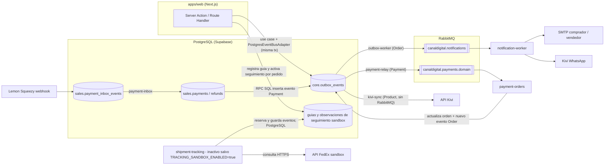
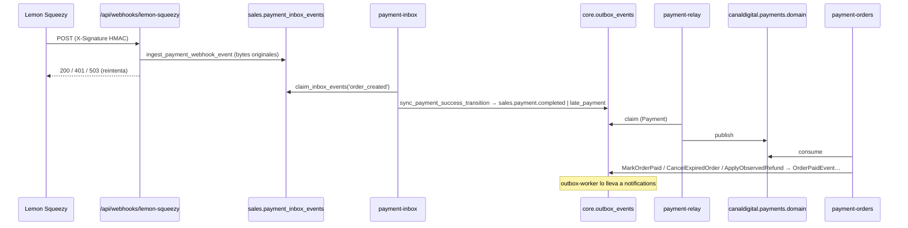
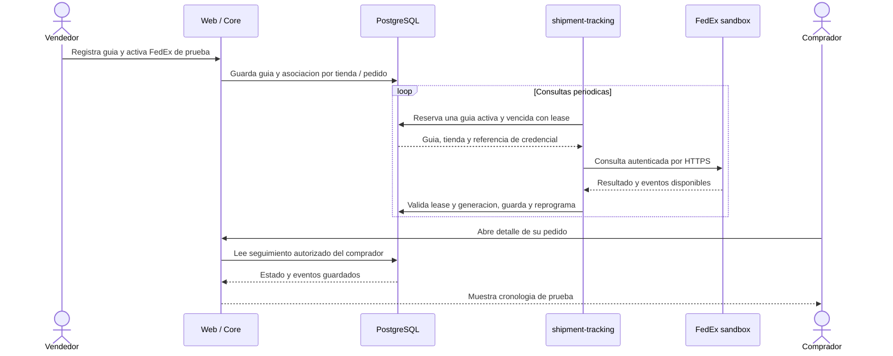

# Workers — Canal Digital Ventas

`apps/worker` agrupa los procesos Node.js que corren **fuera de Next.js** y hacen el trabajo asíncrono del sistema: publicar eventos, enviar notificaciones, procesar pagos y reembolsos, sincronizar el catálogo con Kivi y limpiar datos vencidos.

Cada archivo de `src/` es solo un **punto de entrada** (composition root): carga variables de entorno y llama a una función `run*Worker` de `@canaldigital/packages/core`. Toda la lógica vive en el core.

> Para despliegue (Docker, Coolify, límites de recursos, verificación) ver [`docker/README.md`](docker/README.md).

---

## 1. Idea general: Transactional Outbox + RabbitMQ

El sistema **nunca publica a RabbitMQ desde la web**. Cuando ocurre algo importante, el evento se guarda en la tabla `core.outbox_events` **dentro de la misma transacción** que cambia el negocio. Si la transacción falla, el evento no existe; si se confirma, el evento queda garantizado. Después, un worker lo lee y lo publica.



### ¿De dónde salen los eventos?

| Origen                                                                                                                                 | Cómo se escribe en `core.outbox_events`                                                                                                                                                      | `aggregate_type` | Eventos                                                                                                                                |
| -------------------------------------------------------------------------------------------------------------------------------------- | -------------------------------------------------------------------------------------------------------------------------------------------------------------------------------------------- | ---------------- | -------------------------------------------------------------------------------------------------------------------------------------- |
| Entidad `Order` (`orders/domain/entities/order.entity.ts`)                                                                             | Los casos de uso (`change-order-status`, `cancel-order`, `mark-order-paid`, …) llaman a `PostgresEventBusAdapter.publish(envelopes, tx)` dentro de `TransactionManagerPort.runInTransaction` | `Order`          | `OrderConfirmedEvent`, `OrderPaidEvent`, `OrderProcessingEvent`, `OrderShippedEvent`, `OrderDeliveredEvent`, `OrderCancelledEvent`     |
| Entidad `Product`                                                                                                                      | Igual, al crear, editar, cambiar precio, ajustar stock o archivar                                                                                                                            | `Product`        | `ProductCreatedEvent`, `ProductDetailsChangedEvent`, `ProductPricingChangedEvent`, `ProductStockAdjustedEvent`, `ProductArchivedEvent` |
| RPCs SQL de pagos (`sales.sync_payment_success_transition`, `sales.execute_checkout_timeout_transition`, reconciliación de reembolsos) | `INSERT INTO core.outbox_events` dentro de la función `SECURITY DEFINER`                                                                                                                     | `Payment`        | `sales.payment.completed`, `sales.payment.late_payment`, `sales.payment.checkout_expired`, `sales.payment.refund_observed`             |

El adaptador que inserta los eventos de dominio es `packages/core/src/features/shared/infrastructure/adapters/postgres-event-bus.adapter.ts`. Cada fila nace con `status = 'PENDING'`.

### ¿Quién puede leer cada evento? (`core.outbox_relay_routes`)

Ningún worker lee la tabla directamente. Todos usan la RPC `core.claim_outbox_event_by_type(token, aggregate_type, event_types[])`, que **solo entrega un evento si existe una ruta** `(worker_role, aggregate_type, event_type)` para el rol del login de Postgres que se conecta:

| Rol de BD               | aggregate_type | Eventos permitidos              |
| ----------------------- | -------------- | ------------------------------- |
| `outbox_worker_role`    | `Order`        | los 6 eventos de orden          |
| `outbox_worker_role`    | `Payment`      | los 4 eventos `sales.payment.*` |
| `kivi_sync_worker_role` | `Product`      | los 5 eventos de producto       |

Estas filas se siembran en las migraciones (`20261015000000_rabbitmq_outbox_relay.sql`, `20261015200320_…`, `20261016041424_…`, `20261018183618_…`, `20261020000000_kivi_connections.sql`). **Si agregas un evento nuevo, hay que agregar su ruta en una migración y en la constante TypeScript correspondiente** (`ORDER_NOTIFICATION_EVENTS`, `PAYMENT_ORDER_EVENT_TYPES` o `KIVI_PRODUCT_EVENT_TYPES`).

### Ciclo de vida de una fila del outbox

```
PENDING ──claim──▶ PROCESSING (lease 60 s, attempt_count + 1)
                     │
       publish OK ───┼──▶ complete_outbox_event ──▶ COMPLETED
                     │
     publish falla ──┴──▶ retry_outbox_event ──▶ RETRY (next_attempt_at)
                                                    │
                              attempt_count >= 5 ───┴──▶ DEAD
```

- El `token` es un UUID por conexión del worker. `complete` y `retry` solo funcionan si el lease sigue siendo de ese token; si se perdió, se lanza `OutboxRelayException`.
- Un lease vencido (worker caído) vuelve a quedar disponible para otro claim.
- Los eventos de orden anteriores al 2026-10-15 están en `core.outbox_relay_exclusions` y nunca se publican.

Lógica: `RelayOutboxUseCase` (`shared/application/use-cases/relay-outbox.use-case.ts`) → `claim` → `publish` → `complete` o `retry`.

---

## 2. Formato del mensaje en RabbitMQ

`RabbitMqEventPublisherAdapter` (`shared/infrastructure/adapters/rabbitmq-event-publisher.adapter.ts`) publica con `sendToQueue` en el **exchange por defecto** directamente a la cola, en un _confirm channel_ (espera el ACK del broker, timeout 10 s, un mensaje en vuelo a la vez).

**Body (JSON):**

```json
{
  "messageId": "uuid de la fila del outbox",
  "tenantId": "uuid",
  "aggregateType": "Order",
  "aggregateId": "uuid",
  "eventType": "OrderPaidEvent",
  "occurredAt": "2026-11-06T12:00:00.000Z",
  "payload": { "...": "datos del evento" }
}
```

**Propiedades:** `persistent: true`, `mandatory: true`, `contentType: application/json`, `messageId` (= id del outbox, sirve para idempotencia), `type` (= `eventType`), headers `x-tenant-id` y `x-schema-version: 1`.

### Colas

| Cola                                                    | Publica         | Consume               |
| ------------------------------------------------------- | --------------- | --------------------- |
| `canaldigital.notifications` (`RABBITMQ_QUEUE`)         | `outbox-worker` | `notification-worker` |
| `canaldigital.payments.domain` (`PAYMENT_DOMAIN_QUEUE`) | `payment-relay` | `payment-orders`      |

Para cada cola `Q` se declaran (todas durables):

- `Q.dead-letter`: mensajes que agotaron los reintentos o son inválidos.
- `Q.retry.30000`, `Q.retry.120000`, `Q.retry.600000`, `Q.retry.1800000`: colas con TTL (30 s, 2 min, 10 min, 30 min) que al vencer devuelven el mensaje a `Q`.

**Reintentos del consumidor:** si el procesamiento falla, el consumidor **copia** el mensaje a la cola de retry del intento actual con el header `x-notification-attempt` / `x-consumer-attempt` incrementado, espera la confirmación del broker y luego hace `ack` del original. En el intento 5, o con una excepción permanente, va a `.dead-letter`. `prefetch(1)`: un mensaje a la vez.

Código: `shared/infrastructure/messaging/reliable-queue-consumer.ts` y `notifications/infrastructure/rabbitmq-notification-consumer.ts`.

### Patrón de mensajería: punto a punto (no pub/sub)

RabbitMQ se usa como **cola punto a punto** (_work queue_), no como pub/sub:

- Se publica con `sendToQueue` al exchange por defecto (`""`), que entrega el mensaje **solo** a la cola con ese nombre. No se declaran exchanges (`fanout`/`topic`) ni bindings.
- Cada cola tiene **un único tipo de consumidor**. Si levantas varias réplicas del mismo worker, compiten por los mensajes y cada mensaje lo procesa **una sola** réplica (_competing consumers_); no reciben una copia cada una.

Que un evento llegue a varios destinos no lo resuelve RabbitMQ, sino estas dos piezas:

| Dónde                                      | Qué hace                                                                                                                                                                                   |
| ------------------------------------------ | ------------------------------------------------------------------------------------------------------------------------------------------------------------------------------------------ |
| Base de datos (`core.outbox_relay_routes`) | Decide qué worker lee cada `aggregate_type`/`event_type` (`Order` → `outbox-worker`, `Payment` → `payment-relay`, `Product` → `kivi-sync`). Cada fila del outbox la publica un solo relay. |
| Dentro del `notification-worker`           | Recibe el mensaje una vez y lo reparte en código a comprador, vendedor y Kivi (`DeliverOrderNotificationsUseCase`).                                                                        |

Consecuencia práctica: **agregar un consumidor nuevo del mismo evento** (por ejemplo, analítica) obliga a tocar el publicador o el `notification-worker`. Además, como los destinos comparten un mismo mensaje, un fallo en uno reintenta el mensaje completo; las entregas que ya salieron no se duplican porque cada una queda registrada en la base de datos.

Si en el futuro hiciera falta pub/sub, el cambio sería publicar a un exchange `topic` (por ejemplo `canaldigital.events`, con routing key igual a `eventType`) y darle a cada servicio su propia cola enlazada.

---

## 3. Catálogo de workers

| Servicio (compose)       | Entrada `src/`              | Script pnpm              | Lee de                                                 | Escribe / publica en                            | Puerto health                              |
| ------------------------ | --------------------------- | ------------------------ | ------------------------------------------------------ | ----------------------------------------------- | ------------------------------------------ |
| `outbox-worker`          | `main.ts`                   | `start`                  | outbox (`Order`)                                       | cola `canaldigital.notifications`               | 8081                                       |
| `notification-worker`    | `notifications.ts`          | `notifications`          | cola `canaldigital.notifications`                      | SMTP (comprador y vendedor), Kivi (opcional)    | 8082                                       |
| `payment-inbox`          | `payments.ts`               | `payments`               | `sales.payment_inbox_events` (`order_created`)         | `sales.payments` + outbox (`Payment`)           | 8083                                       |
| `payment-relay`          | `payment-relay.ts`          | `payment-relay`          | outbox (`Payment`)                                     | cola `canaldigital.payments.domain`             | 8085                                       |
| `payment-orders`         | `payment-orders.ts`         | `payment-orders`         | cola `canaldigital.payments.domain`                    | `sales.orders` + outbox (`Order`)               | 8084                                       |
| `payment-dispatch`       | `payment-dispatch.ts`       | `payment-dispatch`       | compensaciones / reembolsos pendientes                 | API de reembolsos de Lemon Squeezy              | 8086                                       |
| `payment-egress`         | `payment-egress.ts`         | `payment-egress`         | — (servidor HTTP en localhost)                         | consultas GET a Lemon Squeezy + evidencia en BD | 8088 (HTTP en `PAYMENT_EGRESS_PORT`, 8090) |
| `payment-reconciliation` | `payment-reconciliation.ts` | `payment-reconciliation` | inbox `order_refunded`, reembolsos, checkouts vencidos | `sales.*` + outbox (`Payment`)                  | 8087                                       |
| `payment-retention`      | `payment-retention.ts`      | `payment-retention`      | evidencia de pagos                                     | borra PII (`sales.purge_payment_pii`)           | 8089                                       |
| `kivi-sync`              | `kivi-sync.ts`              | `kivi-sync`              | outbox (`Product`) + estado de tiendas vinculadas      | API HTTP de Kivi                                | 8091                                       |
| `cart-retention`         | `cart-retention.ts`         | `cart-retention`         | carritos vencidos                                      | borra (`core.purge_expired_buyer_carts`)        | 8092                                       |

`preview-notifications.ts` y `payment-webhook-test-proxy.ts` son utilidades de desarrollo, no servicios.

### 3.1 `outbox-worker` — publica eventos de órdenes

`runOutboxWorker` (`shared/infrastructure/messaging/outbox-worker.ts`):

1. Abre una conexión a Postgres con el login restringido (`OUTBOX_DATABASE_URL`, rol `outbox_worker_role`).
2. Conecta a RabbitMQ y declara la cola y su `.dead-letter`.
3. En bucle: `RelayOutboxUseCase.execute()`. Si no hubo evento, espera `OUTBOX_POLL_INTERVAL_MS` (1 s).
4. Si RabbitMQ o la BD fallan, marca health en `false`, espera 5 s y reconecta.

Solo reclama los eventos de `ORDER_NOTIFICATION_EVENT_TYPES` con `aggregate_type = 'Order'`.

### 3.2 `notification-worker` — envía notificaciones

`runNotificationWorker` (`notifications/infrastructure/notification-worker.ts`):

1. Verifica SMTP y que el login tenga los permisos sobre las RPCs `core.claim_notification_delivery`, `core.read_order_notification`, `core.claim_merchant_notification_delivery`, etc. Si `KIVI_NOTIFICATIONS_ENABLED=true`, también las RPCs de Kivi.
2. Consume `canaldigital.notifications` y, por cada evento, ejecuta `DeliverOrderNotificationsUseCase`, que delega en:
   - `DeliverOrderNotificationUseCase`: email al **comprador**.
   - `DeliverMerchantNotificationsUseCase`: email al **vendedor**.
   - `DeliverKiviOrderNotificationUseCase` (opcional): aviso por **Kivi** (WhatsApp).
3. Cada entrega se registra en BD con un "claim" para no enviar dos veces el mismo correo aunque RabbitMQ redistribuya el mensaje. Si otra instancia la tiene tomada (`BUSY`), se reprograma.
4. Textos: `apps/web/messages/{es,en}.json` → `Notifications.email` y `Notifications.merchant`. Idioma: `NOTIFICATION_LOCALE`.

### 3.3 Flujo de pagos (Lemon Squeezy)



- **Webhook** (`apps/web/app/api/webhooks/lemon-squeezy/route.ts`): verifica la firma, guarda el payload crudo en el inbox y responde. No procesa nada más. Si no pudo guardar, responde 503 para que Lemon Squeezy reintente.
- **`payment-inbox`**: procesa el inbox (`ProcessPaymentInboxUseCase`). La RPC marca el pago como `completed` (o `late_payment_pending_compensation` si la orden ya había expirado) y escribe el evento `Payment` en el outbox, todo en una transacción.
- **`payment-relay`**: es el mismo `runOutboxWorker`, configurado con `aggregate_type = 'Payment'` y la cola `canaldigital.payments.domain`.
- **`payment-orders`**: consume esa cola y aplica el cambio en la **orden** mediante `HandlePaymentOrderEventUseCase`:
  - `sales.payment.completed` → `MarkOrderPaidUseCase`
  - `sales.payment.checkout_expired` → `CancelExpiredOrderUseCase` (devuelve el stock)
  - `sales.payment.refund_observed` → `ApplyObservedRefundToOrderUseCase`
  - Usa un actor de sistema fijo (`00000000-0000-4000-8000-000000000041`) para auditoría.
  - Cada 5 min ejecuta `RepairPaymentOrdersUseCase`, que corrige pagos cuyo efecto sobre la orden quedó pendiente.
  - Los cambios de orden generan eventos `Order` en el outbox, que el `outbox-worker` convierte en notificaciones.
- **`payment-dispatch`**: crea compensaciones para pagos tardíos (`StartPaymentCompensationUseCase`) y ejecuta el POST de reembolso en Lemon Squeezy (`DispatchRefundUseCase`).
- **`payment-egress`**: servidor HTTP solo en `127.0.0.1`, protegido con `PAYMENT_EGRESS_TOKEN`. Hace las consultas GET a Lemon Squeezy y guarda la evidencia. Es el único proceso con la API key para lectura de evidencia.
- **`payment-reconciliation`**: comparte la red con `payment-egress` (`network_mode: service:payment-egress`). Cada 30 s recupera leases abandonados y expira checkouts vencidos (`sales.execute_checkout_timeout_transition` → evento `checkout_expired`). Procesa los webhooks `order_refunded` y concilia reembolsos pidiendo evidencia a `payment-egress`. **Nunca repite un POST de reembolso.**
- **`payment-retention`**: cada hora borra PII de evidencias de más de 30 días, en lotes de 100.

Cada proceso de pagos verifica al arrancar que su login **no** sea superusuario, no evite RLS y pertenezca únicamente a su rol (`payment_worker_role`, `payment_order_domain_role`, `payment_reconciliation_role`, `payment_egress_role`, `payment_retention_role`). Si no se cumple, no arranca.

En local, `loadIsolatedPaymentEnvironment` carga `.local/payment-runtime/<perfil>.env` para que cada proceso vea solo sus credenciales. En Docker se inyectan por servicio.

### 3.4 `kivi-sync` — catálogo hacia Kivi

`runKiviSyncWorker` (`kivi/infrastructure/kivi-sync-worker.ts`) **no usa RabbitMQ**. Reutiliza `RelayOutboxUseCase`, pero el "publisher" es `KiviOutboxEventPublisher`, que llama por HTTP a la API de Kivi:

1. Reclama eventos `Product` del outbox → `SyncKiviProductUseCase` envía el cambio de esa tienda a Kivi.
2. Cada `KIVI_CYCLE_INTERVAL_MS` (2 s) ejecuta `RunKiviSyncCycleUseCase`:
   - **Carga inicial** de tiendas recién vinculadas.
   - **Reconciliación** completa cada `KIVI_RECONCILE_INTERVAL_MS` (6 h), o antes si algún evento quedó `DEAD`.
   - Reintento de tiendas con fallo cada `KIVI_RETRY_INTERVAL_MS` (5 min).
3. Si Kivi responde con error, aplica backoff (respeta `Retry-After`).

Los tokens de cada tienda se guardan cifrados con AES-GCM y se descifran con `KIVI_TOKEN_ENCRYPTION_KEY`, la misma clave que usa la web. Las tiendas antiguas pueden usar `KIVI_CONNECTION_TOKEN_<NOMBRE>` en `kivi-connections.env`.

### 3.5 `cart-retention` — limpieza de carritos

Cada 15 min llama a `core.purge_expired_buyer_carts(batchSize)`. Si borró algo, repite enseguida hasta vaciar el lote.

---

## 4. Patrones comunes

- **Health check:** cada worker abre `GET http://127.0.0.1:<puerto>/health` → `200 {"ready":true}` o `503`. `ready` pasa a `true` solo después de un ciclo exitoso. `WORKER_HEALTH_PORT` sobrescribe el puerto; en compose varios usan 8081 porque cada contenedor tiene su propia red.
- **Apagado limpio:** `SIGINT`/`SIGTERM` disparan un `AbortController`. El worker termina el mensaje en curso, cierra RabbitMQ y Postgres (`stop_grace_period: 90s`).
- **Reconexión:** ante cualquier error de conexión: health en `false`, espera 5 s y reconecta. Los logs nunca incluyen URLs ni credenciales.
- **Mínimo privilegio:** cada servicio usa **su propio login de Postgres** y solo puede ejecutar RPCs `SECURITY DEFINER` concretas. Nada usa la `service_role` de Supabase.
- **Idempotencia:** el `messageId` es el id del outbox, y las entregas o transiciones se registran en BD con claims y leases. Si un mensaje llega dos veces, no tiene efecto doble.
- **Conexiones:** `postgres` con `max: 1`, `prepare: false` (compatible con el pooler de Supabase) y `statement_timeout` de 10 s.

---

## 5. Ejecutar en local

Desde la raíz del repo:

```sh
cp apps/worker/.env.example apps/worker/.env   # solo la primera vez; completar credenciales

# Todo en Docker (RabbitMQ + 10 workers)
pnpm messaging:up
pnpm messaging:logs
pnpm messaging:down

# O procesos sueltos con Node (RabbitMQ en 127.0.0.1:5673)
pnpm worker:outbox
pnpm worker:notifications
pnpm worker:kivi-sync
pnpm worker:cart-retention
pnpm --filter @canaldigital/worker payments        # u otro script de pagos

# Vista previa de los correos sin enviarlos
pnpm --filter @canaldigital/worker notifications:preview
```

`loadWorkerEnvironment` lee `apps/worker/.env` si existe. En Docker o Coolify las variables vienen del entorno del servicio.

No ejecutes workers locales y desplegados contra la misma base de datos: competirían por los mismos eventos.

---

## 6. Agregar un evento o un consumidor nuevo

1. Emite el evento desde la entidad de dominio y persístelo con `EventBusPort.publish(envelopes, tx)` dentro de la transacción del caso de uso.
2. Crea una migración que inserte la ruta en `core.outbox_relay_routes` para el rol del worker que debe leerlo.
3. Agrega el `event_type` a la constante TypeScript del worker (`ORDER_NOTIFICATION_EVENTS`, `PAYMENT_ORDER_EVENT_TYPES`, `KIVI_PRODUCT_EVENT_TYPES`).
4. Si es un consumidor nuevo: crea una función `run*Worker` en el core que use `assertReliableQueueTopology` y `processReliableQueueMessage`, su entrada en `apps/worker/src/`, un script en `package.json` y un servicio en `compose.rabbitmq.yml` con su propio login de BD.

### Avisos de cambios de guía

Para activar avisos de cambios de guía, aplicar primero las migraciones de destinatario verificado y de ruta de outbox, verificar permisos del rol y configurar `SHIPMENT_NOTIFICATIONS_ENABLED=true` primero en el worker de outbox y después en la aplicación web. Mientras esté deshabilitado en web, no se generan avisos de guía retroactivos; los avisos existentes continúan. Validar el flujo de correo y credenciales en el entorno de destino antes de habilitarlo.

Para avisos de reembolso, aplicar también la migración de ruta de reembolso y habilitar `REFUND_NOTIFICATIONS_ENABLED=true` y configurar `REFUND_NOTIFICATIONS_SINCE` con el instante de activación en ISO UTC (por ejemplo `2026-11-08T12:00:00Z`) en el worker de outbox. Los eventos anteriores al corte se completan sin enviarse; los eventos posteriores se notifican. Ambos indicadores se controlan de forma independiente.

## Creación de guías FedEx (solo sandbox)

El worker `shipment-creation` **no usa RabbitMQ**. Toma de uno en uno los trabajos de `sales.shipment_creation_jobs` en estado `queued` (o `creating` con la concesión vencida), crea la guía en FedEx sandbox, guarda la etiqueta PDF en el bucket privado `shipment-labels`, registra la guía en el pedido y activa el seguimiento, todo en una sola transacción. Un trabajo que quedó en `creating` tras un fallo del proceso pasa a `needs_attention` (`AMBIGUOUS_RESULT`) y nunca se reintenta automáticamente, porque FedEx podría haber creado ya la guía.

- El servicio `shipment-creation` está en `compose.rabbitmq.yml` sin perfil, para que Coolify registre sus variables (todas opcionales). Mientras `SHIPMENT_CREATION_SANDBOX_ENABLED` no sea exactamente `true`, queda inactivo y sano: no se conecta a la base, a FedEx ni a Storage. Activado con configuración inválida, termina con error y Docker lo reinicia; el error no incluye valores. Un fallo del bucle deja el healthcheck en no listo.
- Con SIGTERM termina el trabajo en curso y sale.
- La base debe llevar la misma marca sandbox que el seguimiento (`TRACKING_DEPLOYMENT_ID`, y `PRODUCTION_DATABASE_URL` si existe una base de producción real).
- La migración `20261110050000_provision_shipment_creation_worker_login.sql` crea el login técnico `canaldigital_shipment_creation` con `PASSWORD NULL` y le concede `shipment_creation_worker_role`. El operador debe asignar una contraseña fuerte una sola vez, fuera del repositorio, y construir `SHIPMENT_CREATION_DATABASE_URL` con ella:

```sql
ALTER ROLE canaldigital_shipment_creation WITH PASSWORD '<generated>';
```

Variables obligatorias al activar: `SHIPMENT_CREATION_SANDBOX_ENABLED=true`, `SHIPMENT_CREATION_DATABASE_URL`, `TRACKING_DEPLOYMENT_ID` (UUID), `TRACKING_CREDENTIALS_JSON` (el mismo formato que el seguimiento), `FEDEX_SANDBOX_ACCOUNT_NUMBER`, `FEDEX_SERVICE_TYPE` (por ejemplo `FEDEX_GROUND`), `SHIPMENT_CREATION_TENANT_REFS_JSON` (objeto JSON que asocia cada UUID de tienda con una referencia presente en `TRACKING_CREDENTIALS_JSON`), `SHIPMENT_CREATION_SYSTEM_ACTOR_ID` (UUID del actor que se registra en el historial de la guía), `SHIPMENT_CREATION_LABELS_SUPABASE_URL` y `SHIPMENT_CREATION_LABELS_SERVICE_ROLE_KEY` (solo para escribir etiquetas en Storage). Opcionales: `SHIPMENT_CREATION_POLL_INTERVAL_MS` (mínimo 1000, predeterminado 5000) y `SHIPMENT_CREATION_LEASE_SECONDS` (de 180 a 3600, predeterminado 180; el peor caso de un trabajo ronda los 140 s: token, llamada a FedEx con renovación por 401 y reintento, subida de la etiqueta y transacción final). Entregar los secretos mediante el sistema de secretos del despliegue.

La web solo encola trabajos cuando tiene `SHIPMENT_CREATION_SANDBOX_ENABLED=true` (valor exacto) **y** una configuración sandbox de seguimiento válida (`TRACKING_SANDBOX_ENABLED=true`, `TRACKING_DEPLOYMENT_ID`, `TRACKING_TENANT_REFS_JSON`). Configurar esa variable en la web **del mismo despliegue** que ejecuta este worker; en cualquier otro entorno (por ejemplo producción) debe quedar desactivada, porque nada consumiría los trabajos.

Inicio manual: `pnpm --filter @canaldigital/worker shipment-creation`. Los registros del bucle contienen solo la clase de la excepción y el identificador del pedido; nunca causas del controlador, tokens ni contenido de etiquetas.

## Cómo se procesan las guías FedEx

El worker `shipment-tracking` **no usa RabbitMQ ni consume los eventos del outbox**. La tienda registra una guía en el pedido y activa expresamente «FedEx de prueba»; la aplicación guarda una asociación por pedido y tienda en `sales.shipment_tracking_links`. Un pedido nuevo o una guía manual sin activación no entran automáticamente en el seguimiento.



- El worker consulta una asociación a la vez con `FOR UPDATE SKIP LOCKED`; solo toma guías activas, no pausadas, pendientes y que sigan coincidiendo con la guía manual. La reserva vence a los dos minutos y puede recuperarse.
- La referencia de credencial identifica la configuración de la tienda; los secretos se resuelven en el worker. Por defecto se programa otra consulta a los 30 minutos, con variación; para resultados terminales se usa el intervalo configurado (24 horas por defecto).
- Una falla temporal reprograma con espera creciente; una falla de autorización pausa la asociación. Si la guía cambia o se desactiva mientras hay una consulta en curso, el control de generación y lease evita aplicar la respuesta antigua.
- Las observaciones se almacenan en `sales.shipment_tracking_observations` y la web las consulta bajo autorización. Un evento de FedEx no cambia automáticamente el estado comercial del pedido. Las notificaciones de pedidos o cambios manuales de guía siguen sus propios flujos de outbox y RabbitMQ cuando están habilitados; los eventos de seguimiento FedEx no crean mensajes RabbitMQ.
- El servicio `shipment-tracking` está en `compose.rabbitmq.yml` sin perfil, para que Coolify registre sus variables (todas opcionales). Comparte la imagen y el healthcheck, pero no depende de RabbitMQ. Mientras `TRACKING_SANDBOX_ENABLED` no sea `true`, queda inactivo y sano: no se conecta a la base ni a FedEx. Activado, el healthcheck indica que el worker completó un ciclo sin error; no garantiza que FedEx tenga eventos o que cada guía esté activa. Activado con configuración inválida, termina con error y Docker lo reinicia.
- Con las variables y permisos preparados, usa `docker compose --env-file apps/worker/.env -f compose.rabbitmq.yml up -d shipment-tracking`. En Coolify establece las variables del servicio y `TRACKING_SANDBOX_ENABLED=true`; no hace falta `COMPOSE_PROFILES`. La imagen compartida debe haberse construido previamente.

## Seguimiento FedEx (solo sandbox)

El sandbox de FedEx puede ejecutarse en un despliegue compilado con `NODE_ENV=production` si el despliegue y sus datos están destinados a pruebas. Tanto web como worker requieren `TRACKING_SANDBOX_ENABLED=true`; la API utilizada sigue siendo exclusivamente la de FedEx sandbox. La base debe llevar la marca sandbox coincidente. Si existe una base de producción real, debe estar físicamente separada y su identidad debe configurarse como `PRODUCTION_DATABASE_URL`; la comparación de URLs no detecta todos los alias de red, por lo que operación debe verificarlo independientemente. Las migraciones y la conexión con FedEx deben validarse en el entorno de destino.
En el entorno de pruebas, aplicar las migraciones mediante el proceso habitual y validar RLS, propietario de la función de fencing y roles. Como administrador de la base de pruebas, insertar una única marca `sales.shipment_tracking_environment` con `environment = 'sandbox'` y un UUID nuevo `deployment_id`; ese mismo UUID es `TRACKING_DEPLOYMENT_ID` en web y worker. Ejemplo para una base de pruebas, sustituyendo el UUID generado:

```sql
INSERT INTO sales.shipment_tracking_environment (singleton, environment, deployment_id)
VALUES (true, 'sandbox', '00000000-0000-4000-8000-000000000001');
```

No ejecutes la inserción si ya existe una marca; comprueba primero que coincida con el despliegue. La migración `20261109200544_provision_shipment_tracking_worker_login.sql` crea el login técnico `canaldigital_shipment_tracking` con `PASSWORD NULL` y le concede `shipment_tracking_worker_role`. El operador debe asignar una contraseña fuerte fuera del repositorio antes de construir `TRACKING_DATABASE_URL`. No proporcionar a ese login permisos generales de administración ni credenciales de otra base.

Variables del servidor web de pruebas: `TRACKING_SANDBOX_ENABLED=true`, `DATABASE_URL` de la base de pruebas, opcionalmente `PRODUCTION_DATABASE_URL` con la identidad de una base de producción real para comparación sin usarla para conectarse, `TRACKING_DEPLOYMENT_ID` y `TRACKING_TENANT_REFS_JSON`, un objeto JSON que asocia cada UUID de tienda con una referencia no secreta. La conexión web debe tener los permisos de aplicación necesarios sobre las tablas de seguimiento y la función de fencing debe conservar su propietario autorizado. La selección de FedEx es explícita en el detalle de la tienda.

Variables del worker: las mismas `TRACKING_SANDBOX_ENABLED`, `PRODUCTION_DATABASE_URL` (si existe) y `TRACKING_DEPLOYMENT_ID`; `TRACKING_DATABASE_URL` con el login técnico de pruebas; `TRACKING_CREDENTIALS_JSON`, objeto JSON cuyas claves son las referencias de cada tienda y cuyos valores contienen `clientId` y `clientSecret` de FedEx sandbox; opcionalmente `TRACKING_INTERVAL_MS` (mínimo 60000, predeterminado 1800000) y `TRACKING_MIN_SPACING_MS` (mínimo 1000) `TRACKING_TERMINAL_INTERVAL_MS` (por defecto 86400000, al menos el intervalo normal) y `TRACKING_RETENTION_DAYS` (90 a 3650 días, por defecto 90). Entregar secretos a través del sistema de secretos del despliegue; no guardarlos en archivos versionados ni incluirlos en registros o capturas. Las credenciales FedEx se obtienen en el portal de desarrolladores, con Basic Integrated Visibility habilitado para el proyecto de pruebas.

Solo después de validar la configuración, iniciar el proceso en el entorno dedicado con `pnpm --filter @canaldigital/worker shipment-tracking`. Los registros `shipment_tracking_result` contienen únicamente `applied`, `stale`, `paused` o `error`; `shipment_tracking_metrics` registra cada cinco minutos conteos agregados de asociaciones activas, pausadas, con errores y pendientes, y la antigüedad máxima de una consulta exitosa. La antigüedad es null si ninguna ha tenido éxito. Configurar alertas por errores, pausas y antigüedad en la plataforma de observabilidad elegida; no hay un panel de alertas instalado por este cambio. Una falla de autorización persistente pausa la guía afectada y registra el resultado agregado `paused`; tras corregir las credenciales, la tienda puede reactivar la consulta. FedEx puede devolver eventos desconocidos o respuestas no compatibles; no se interpreta una consulta fallida como una entrega.

Antes de cualquier activación real, probar con una guía sandbox documentada y verificar autenticación, evento confirmado, credenciales de otra tienda, permisos del comprador y vendedor, cambio de guía durante una consulta, duplicados y reintentos. Validar el SQL con dos conexiones reales y confirmar que ningún resultado de sandbox aparece en datos reales. El acceso, cobertura y límites de FedEx dependen de la cuenta y la región. El seguimiento autenticado FAD, que la API básica puede rechazar, aparece como no compatible; no hay webhooks ni cambio automático del estado comercial. El mantenimiento elimina observaciones vencidas y conserva la última recibida, la última con hora y la última con solo fecha de cada asociación activa; requiere validar SQL y permisos en la base de pruebas antes de iniciar el worker. Las alertas operativas y la validación real del proveedor aún requieren comprobación antes de producción.

Para las pruebas de permisos, aplicar las migraciones únicamente en una base local dedicada llamada `cdv_tracking_test` en el puerto 55439 y ejecutar `pnpm exec vitest run supabase/tests/shipment-tracking.integration.test.ts` con `TRACKING_TEST_DATABASE_URL` apuntando a esa base. Para probar dos conexiones y recuperación de concesiones, preparar un pedido de prueba con guía y asociación sandbox, un comprador propietario y otro ajeno; configurar TRACKING_TEST_WORKER_DATABASE_URL, TRACKING_TEST_TENANT_ID, TRACKING_TEST_ORDER_ID, TRACKING_TEST_BUYER_ID, TRACKING_TEST_OTHER_BUYER_ID, TRACKING_TEST_DEPLOYMENT_ID y TRACKING_TEST_ALLOW_MUTATION=1, y ejecutar pnpm exec vitest run supabase/tests/shipment-tracking-fencing.integration.test.ts. La prueba modifica y restaura ese fixture; úsala únicamente en una base local desechable y nunca en producción. No valida el sandbox de FedEx.
